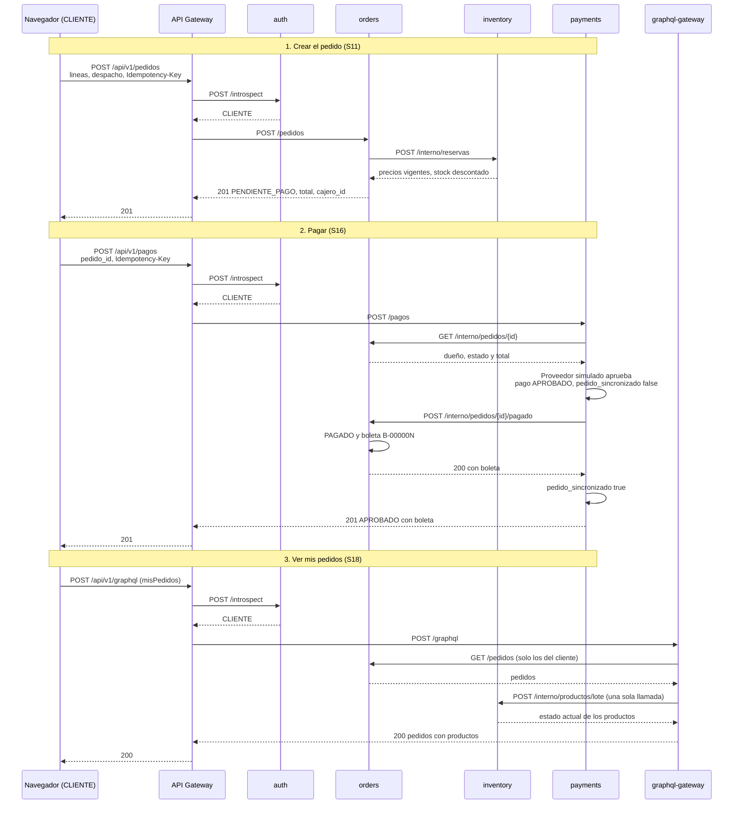

# M3. Matriz de sistemas, mapa de componentes y secuencia de una compra

Mapa de componentes: `docs/componentes.drawio` (se abre en app.diagrams.net).

**Fuente:** código de `main` (commit `6907414`, con orders, payments, GraphQL y el front ya mergeados), `docker-compose.yml` y las "Notas para el informe" de los PR #32 (orders), #33 (payments) y #37 (GraphQL).

## 1. Sistemas

| Sistema | Responsabilidad | Datos que maneja (base propia) | Servicios del M1 | Depende de | Contrato | Credencial | Respuesta ante fallos | Tipo de dependencia |
|---|---|---|---|---|---|---|---|---|
| gateway | Único punto de entrada: lista blanca, sesión, roles, `X-Request-ID` y reenvío. También sirve el front (archivos estáticos) en el mismo origen, `http://localhost:8000` | No guarda datos | Todos (S01 a S19) | auth, inventory, orders, payments, graphql-gateway, Vault | `docs/m1-servicios.md` y `docs/m6-rutas-secretos.md` | Token de Vault de solo lectura; un secreto por servicio | Plazo de 5 s: 504 si un servicio no responde a tiempo, 502 si no está disponible; 503 si Vault no responde y no hay caché | Real |
| auth | Usuarios, contraseñas (bcrypt) y sesiones | Base `auth`: usuarios y sesiones (solo el hash del token) | S06, S07, S08 | MongoDB | `/login`, `/introspect`, `/logout` | `auth_introspection_secret` | Si auth cae, el gateway no puede validar sesiones: las rutas con sesión fallan y el catálogo anónimo sigue funcionando | Real |
| inventory | Catálogo, precios y stock | Base `inventory`: productos | S01 a S05 y operaciones internas de stock y de lectura por lote | MongoDB | `/productos`, `/interno/reservas`, `/interno/devoluciones`, `/interno/productos/lote` | `backend_shared_secret` (gateway), `ORDERS_INVENTORY_SECRET` (orders) y `GRAPHQL_INVENTORY_SECRET` (graphql-gateway, solo lectura) | Descuenta cada línea de forma atómica, solo si alcanza el stock; si una línea falla, devuelve las ya descontadas y responde 409 `STOCK_INSUFICIENTE` | Real |
| orders | Pedidos, estados, anulación, despacho, boleta y reporte de ventas | Base `orders`: pedidos (con líneas, historial, despacho, `cajero_id`, `request_id` y boleta) y contador de boletas | S11 a S15 y S19 | inventory, MongoDB | `/pedidos`, `/reportes/ventas`, `/interno/pedidos/*` | `orders_shared_secret` (gateway), `PAYMENTS_ORDERS_SECRET` (payments) y `GRAPHQL_ORDERS_SECRET` (graphql-gateway, solo para leer pedidos) | Plazo de 3 s hacia inventory (menor que el del gateway, para saber qué servicio falló): 504 si tarda, 502 si está caído. Si la devolución de stock falla al anular, el pedido queda ANULADO con `stock_devuelto: false` y el evento `stock_return_failed` en el log | Real |
| payments | Pagos, idempotencia, aviso del proveedor y reconciliación con orders | Base `payments`: pagos (con `idempotency_key`, `request_id` y `pedido_sincronizado`) | S16, S17 | orders, proveedor de pagos, MongoDB | `/pagos`, `/pagos/aviso` | `payments_shared_secret` (gateway), `PAYMENTS_ORDERS_SECRET` y `PAYMENT_PROVIDER_SECRET` | Si orders no responde al confirmar un pago, el pago queda APROBADO con `pedido_sincronizado: false` y se reintenta solo cada 15 s, con un aviso repetido o con un reintento del cliente | Real |
| graphql-gateway | Agregar en una consulta los pedidos del cliente (orders) con el estado actual de cada producto (inventory) | No guarda datos | S18 (`misPedidos` y `pedido`) | orders, inventory | `POST /graphql` (solo POST, sin GraphiQL) | `graphql_shared_secret` (gateway → graphql-gateway), `GRAPHQL_ORDERS_SECRET` y `GRAPHQL_INVENTORY_SECRET` | Plazo de 3 s hacia cada servicio. Si inventory no responde, devuelve los pedidos con `producto: null` y el detalle en `errors` (error parcial). Si orders no responde, devuelve el error `UPSTREAM_UNAVAILABLE` o `UPSTREAM_TIMEOUT` sin datos | Real |
| Proveedor de pagos | Aprobar o rechazar el cobro | Ninguno propio | S17 (llama al sistema) | — | Aviso `{pago_id, resultado, referencia_proveedor}` | `PAYMENT_PROVIDER_SECRET` | Modo `aviso`: el pago queda PENDIENTE hasta que llega el aviso. Un aviso repetido o tardío no cambia el resultado | **Doble de prueba** (simulador dentro de payments, no es Webpay) |
| clients | Registro de clientes con RUN y perfil, y verificación del correo | Base `clients`: clientes (RUN y correo únicos, dirección, teléfono, `verificado`, hash del código). No guarda claves | S09, S09V, S10 | auth (crear y activar la credencial), MongoDB | `/clientes`, `/clientes/{id}/verificar`, `/clientes/me` | `clients_shared_secret` (gateway) y `CLIENTS_AUTH_SECRET` (clients → auth) | Plazo de 3 s hacia auth: 504 o 502 y no se crea el perfil. Si el perfil falla después de crear la credencial (registro duplicado en carrera), clients revierte la credencial inactiva en auth | Real |
| Vault | Guardar los secretos del gateway | `secret/gateway` | — | — | API de Vault | Token raíz (solo `vault-init`) | Ver `docs/m6-rutas-secretos.md`, sección 6 | Real, en modo dev |
| MongoDB | Persistencia de cada servicio | Una base por servicio | — | — | Driver de Mongo | Usuario raíz (brecha del M6) | Si cae, todos los servicios con datos fallan | Real |
| API de mensajería | Validar correos y enviar boletas (R08, R11) | — | — | — | — | — | — | **No existe** en la U2: brecha declarada |

## 2. Despacho y boletas

No son servicios aparte, sino partes de orders, como se acordó en los recortes:

- **Despacho:** estados PAGADO → EN_DESPACHO → ENTREGADO, que solo mueven DESPACHO o ADMIN (S14 y S15). La cola muestra los pedidos vendidos del más antiguo al más nuevo según su creación (R13).
- **Reporte de ventas:** cuenta cada venta el día en que se pagó (`pagado_en`), no el día en que se creó el pedido.
- **Boleta (R08 parcial):** orders la numera (`B-000001`, `B-000002`…) solo cuando payments marca el pedido como PAGADO, con neto, IVA 19 % y total. El envío por correo es brecha declarada.

## 3. Reglas entre sistemas

1. **Solo payments decide que un pedido está pagado.** orders no tiene ninguna ruta pública para eso; payments usa `/interno/pedidos/{id}/pagado`, con su propio secreto.
2. **El servidor calcula los montos.** El precio de cada línea sale de inventory, el total lo calcula orders y el monto del pago lo saca payments desde orders. Si el front manda precio, total, monto o estado, se ignoran.
3. **Cada servicio solo modifica sus propios datos.** orders no toca el stock directamente: se lo pide a inventory.
4. **No se cobra dos veces:** `Idempotency-Key` obligatorio en pedidos y pagos, un segundo pago del mismo pedido responde 409 y, si dos pagos se aprobaran a la vez, orders acepta solo el primero.
5. **Anular no es borrar:** el pedido pasa a ANULADO con motivo e historial, y el stock se devuelve. Solo se anula un pedido PENDIENTE_PAGO; si no, 409 `TRANSICION_INVALIDA`.

## 4. Secuencia de una compra

Recorrido según el código de `main` (`6907414`), con el proveedor en modo inmediato (el que viene por defecto). Desde el navegador, el front hace estas mismas llamadas.

Si orders no responde en el último paso, el pago queda APROBADO con `pedido_sincronizado: false` y payments reintenta solo hasta que orders responde.

### Evidencias de cada tramo

| Tramo | Evidencia | `request_id` | Qué muestra |
|---|---|---|---|
| Crear pedido | `evidencias/u2/pedido-idempotente/` | `crear-pedido-0001` | Precio del front ignorado, reintento sin duplicar, el mismo ID en gateway, auth, inventory, orders y Mongo |
| Pagar | `evidencias/u2/pago-idempotente/` | `pagar-pedido-0001` | Monto del front ignorado, pago aprobado, pedido PAGADO con boleta B-000002, reintento sin duplicar y segundo pago rechazado |
| Pagar con orders caído | `evidencias/u2/pago-orders-caido/` | `aviso-orders-caido-1` | Pago APROBADO sin sincronizar mientras orders estaba apagado y sincronizado solo al volver |
| Ver mis pedidos | `evidencias/u2/graphql-agregacion/` | `gql-mispedidos-0002` | Pedidos de orders con productos de inventory, con una sola llamada a inventory |
| Ver mis pedidos con inventory caído | `evidencias/u2/graphql-error-parcial/` | `gql-inventory-caido-0002` | Pedidos visibles y `producto: null` con `UPSTREAM_UNAVAILABLE` en `errors` |

Son ejecuciones distintas: el seed reutiliza los ID `PED-0003` y `PAG-0002` en cada reset. La evidencia `pago-idempotente` es anterior a la reconciliación (commit `7537e34`), por eso en sus logs no aparece `order_synced`.

## 5. Límites conocidos

1. **Stock descontado sin pedido:** si inventory responde después de que orders dejó de esperar (3 s), el stock puede quedar descontado sin que exista el pedido. Arreglarlo requiere reservas con ID propio. Queda como candidato a incidencia en la U3.
2. **Cola de despacho por fecha de creación:** la cola ordena por la fecha en que se creó el pedido, no por la del pago.
3. **Devolución de stock sin reintento:** si inventory no responde al anular, el stock no se devuelve solo; queda `stock_devuelto: false` para corregirlo a mano.
4. **Proveedor simulado:** en la U3 se prueba el contrato simulado, no una integración real con Webpay.
