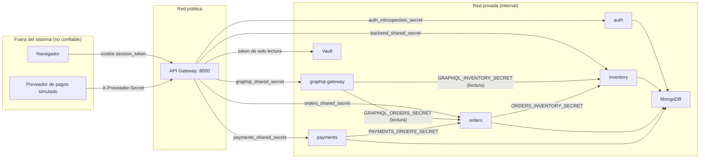
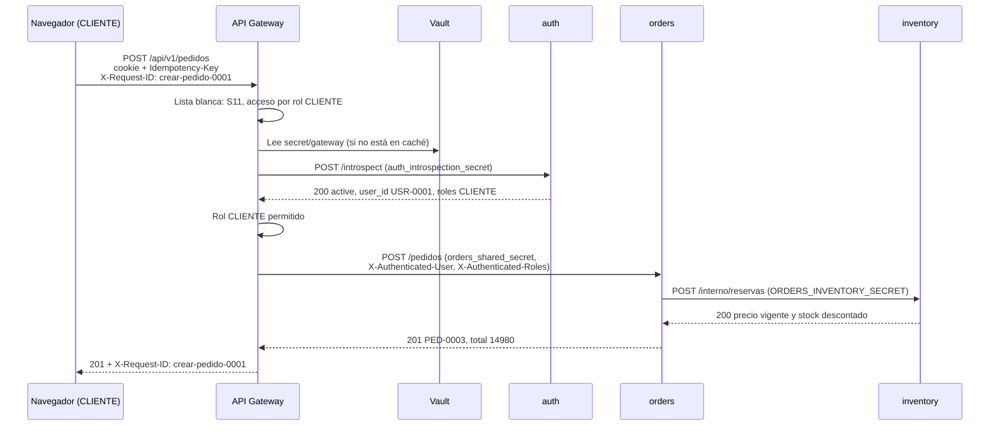
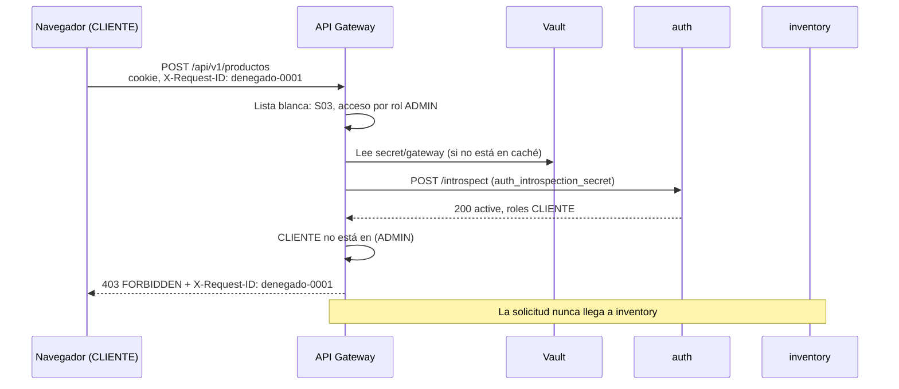

# M5. API Gateway, fronteras de confianza y recorridos

Diagrama de clases: `docs/uml-gateway.drawio` (se abre en app.diagrams.net).

**Fuente:** `backend/gateway/gateway.py`, `backend/gateway/observabilidad.py`, `backend/graphql-gateway/main.py` y `docker-compose.yml` en `main` (commit `5ee71b8`). El detalle de GraphQL está en `docs/m8-graphql.md`.

## 1. Un solo gateway

Chocomanía usa **un único API Gateway**. Se eligió uno solo porque:

- Hay un solo tipo de cliente (el front web) y un solo punto de entrada público.
- La carga proyectada es baja (menos de 25 solicitudes por segundo en el peak, ver `docs/m9-carga.md`).
- Un solo lugar concentra la lista blanca, la validación de sesión, el `X-Request-ID` y la lectura de secretos, así que es más fácil de revisar y probar.

El GraphQL Gateway no es un segundo punto de entrada: es privado (sin puerto publicado) y solo se llega a él a través del API Gateway, por S18. El API Gateway también sirve los archivos del front en el mismo origen (`http://localhost:8000`), así que el navegador no necesita CORS.

## 2. Clases del diagrama

| Clase | Qué representa | Dónde está en el código |
|---|---|---|
| ApiGateway | La aplicación FastAPI del gateway: registra las rutas de la lista blanca, las reenvía y sirve el front estático | `gateway.py` (`app`, `registrar`, `reenviar`, `login`, `logout`, `me` y el montaje de `FRONTEND_DIR`) |
| RouteDefinition | Una ruta permitida: ID del M1, verbo, ruta externa, tipo de acceso, roles, destino y ruta interna | `gateway.py` (`@dataclass RouteDefinition`, lista `RUTAS`) |
| ServiceTarget | Un servicio destino: URL interna y nombre de su secreto en Vault | `gateway.py` (`@dataclass ServiceTarget`, diccionario `SERVICIOS`) |
| AuthenticationPolicy | Valida la cookie `session_token` con auth (`/introspect`) y arma la identidad | `gateway.py` (funciones `obtener_identidad` y `llamar_auth`) |
| AuthorizationPolicy | Decide si la identidad cumple el acceso de la ruta: anónimo, autenticado o rol | `gateway.py` (handler dentro de `registrar`) |
| SecretProvider | Lee los secretos de `secret/gateway` en Vault con un token de solo lectura, con caché de 60 s | `gateway.py` (función `secretos`) |
| Observabilidad | Middleware de `X-Request-ID`, logs JSON y formato único de error | `observabilidad.py` (`instalar`, `log`, `respuesta_error`) |
| GraphQLGateway | Servicio privado que exige su secreto, arma el contexto con la identidad y aplica los límites | `graphql-gateway/main.py` (`app`, `contexto`, `GraphQLRouter`) |
| Schema | Queries `misPedidos` y `pedido`, tipos y límites de profundidad (6), alias (10) y tokens (1000) | `graphql-gateway/main.py` (`Query`, `SchemaConLogs`) |
| Resolver | Resuelve cada campo; `Linea.producto` usa un DataLoader para pedir todos los productos en una sola llamada | `graphql-gateway/main.py` (`mis_pedidos`, `pedido`, `Linea.producto`, `cargador_productos`) |

En el código, AuthenticationPolicy, AuthorizationPolicy y SecretProvider son **funciones**, no clases. En el diagrama se muestran como clases para separar sus responsabilidades.

## 3. Clasificación de rutas

| Tipo | Rutas | Qué exige el gateway |
|---|---|---|
| Anónimas | S01, S02 (catálogo), S06 (login), S07 (logout, con o sin sesión) | Nada. Igual pasan por la lista blanca, la validación de parámetros y el `X-Request-ID` |
| Externa con secreto propio | S17 (aviso del proveedor de pagos) | Nada en el gateway; payments exige `X-Proveedor-Secret` |
| Autenticadas | S08, S12, S13, S18 | Sesión vigente. La propiedad del pedido la revisa orders; en S18, el rol y el campo los revisa graphql-gateway |
| Por rol | S03 a S05 (ADMIN), S11 y S16 (CLIENTE), S14 y S15 (DESPACHO o ADMIN), S19 (DUENO o ADMIN) | Sesión vigente y rol permitido. El servicio vuelve a revisar el rol |
| Front estático | `GET /`, `/*.html`, `/js/*`, `/css/*`, `/img/*` | Nada: son archivos públicos. Solo se sirven archivos de la carpeta `frontend/` |
| Internas (no expuestas) | `/interno/*` de inventory y orders, `/introspect` y `/logout` de auth, `/graphql` de graphql-gateway, `/health` de cada servicio | No están en la lista blanca: desde fuera responden 404 |
| No implementadas | S09, S10 (clients) | Recorte declarado: el registro y el perfil quedan en el front |

## 4. Fronteras de confianza

| Frontera | Qué no se confía | Cómo se controla |
|---|---|---|
| 1. Navegador → gateway | Nada de lo que manda el navegador | Lista blanca de rutas y verbos; parámetros validados (`^[A-Za-z0-9_-]{1,64}$`); sesión validada con auth en cada solicitud; los `X-Authenticated-*` del navegador se descartan; `X-Request-ID` se acepta solo si es válido; solo se reenvían `content-type`, `idempotency-key` y `x-proveedor-secret` |
| 2. Proveedor → gateway → payments | El aviso de pago | payments revisa `X-Proveedor-Secret` y procesa cada aviso una sola vez |
| 3. Gateway → servicios internos | Que alguien llame a un servicio sin pasar por el gateway | Red privada sin acceso desde fuera; cada servicio exige su propio `X-Gateway-Secret`; solo con ese secreto confía en `X-Authenticated-User` y `X-Authenticated-Roles` |
| 4. Servicio → servicio | Que un servicio use una operación que no le corresponde | Secretos distintos por integración: orders → inventory, payments → orders y graphql-gateway → orders e inventory. Los de graphql-gateway solo sirven para leer |
| 5. Gateway → Vault | Que el gateway lea más de lo que necesita | Token con política de solo lectura sobre `secret/gateway` |
| 6. Servicios → MongoDB | — | Cada servicio usa su propia base, pero todos con el usuario raíz (brecha declarada en el M6) |

## 5. Recorrido de una solicitud autorizada

**Caso:** un CLIENTE crea un pedido (S11). Es la ejecución real guardada en `evidencias/u2/pedido-idempotente/logs.txt` (rama `feat/orders`), con `request_id` **`crear-pedido-0001`**.

Las líneas de log, todas con `request_id: crear-pedido-0001`, en orden:

| Hora (UTC) | Servicio | Evento | Detalle |
|---|---|---|---|
| 13:51:34.548 | gateway | `secret_loaded` | Lee `secret/gateway`; registra solo los nombres de las claves |
| 13:51:34.611 | auth | `request` | `POST /introspect` → 200 |
| 13:51:35.230 | inventory | `request` | `POST /interno/reservas` → 200 |
| 13:51:35.260 | orders | `order_created` | `PED-0003`, `USR-0001`, total 14980 |
| 13:51:35.263 | orders | `request` | `POST /pedidos` → 201 |
| 13:51:35.266 | gateway | `request` | `POST /api/v1/pedidos` → 201, `USR-0001`, 800 ms |

## 6. Recorrido de una solicitud denegada

**Caso:** un CLIENTE intenta crear un producto (S03, solo ADMIN). Recorrido según el código; todavía no hay una ejecución guardada como evidencia (corresponde a la prueba P03 del protocolo).

Lo que se espera ver:

- Respuesta: `403` con `{ "error": { "code": "FORBIDDEN", "message": "No tienes permiso para esta operacion", "request_id": "denegado-0001" } }`.
- Logs con el mismo `request_id`: auth (`/introspect` → 200) y gateway (`POST /api/v1/productos` → 403). **Ninguna línea de inventory.**
- Si el navegador manda además `X-Authenticated-Roles: ADMIN` para engañar al gateway, el resultado es el mismo, porque ese header se descarta.

Otras denegaciones que corta el gateway antes de llegar al servicio: sin cookie (401 `UNAUTHENTICATED`), sesión vencida (401 `SESSION_INVALID`), ruta o verbo fuera de la lista blanca (404 o 405) e ID con formato inválido (400 `INVALID_ID`).
