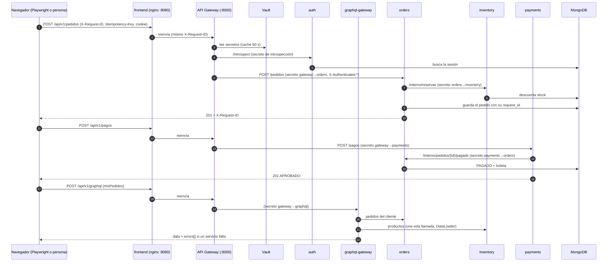

# Entrega 3 — Etapa 1: línea base, entorno y alcance

**Caso:** 19 "Sistema de Ventas On-line", adaptado a Chocomanía (chocolatería artesanal)
**Equipo:** Florencia Pacheco y Karla Muñoz
**Versión de partida (línea base):** tag `u2-final` (commit `566dea1`, 9 de noviembre de 2026)
**Versión evaluada:** tag `u3-final` (se crea al cerrar la Etapa 5; ver `docs/u3/protocolo-u3.md`)

Los identificadores R, S y F son los mismos de la Unidad 2 (`docs/m1-servicios.md`). No se renumeran.

---

## 1. Ficha del entorno

| Elemento | Valor |
|---|---|
| Cómo se levanta | `docker compose up -d --build --wait` desde la raíz del repo (ver `README.md`) |
| Configuración | `.env` creado desde `.env.example` (o con `scripts/generar-env.py`). Nunca se sube al repo. Las variables de prueba (`AUTH_TOKEN_TTL`, `INVENTORY_FAULT_DELAY_MS`) tienen valores por defecto en `docker-compose.yml` |
| Puntos de entrada | `http://localhost:8080` (contenedor `frontend`, nginx) y `http://localhost:8000` (API Gateway). Las pruebas de la U3 entran por `frontend`, como una persona |
| Servicios propios | gateway, auth, clients, inventory, orders, payments, graphql-gateway (FastAPI, Python 3.12), cada uno en su contenedor |
| Infraestructura | MongoDB 7.0.14, HashiCorp Vault 1.17.6 (modo dev), nginx 1.27.2 |
| Datos de prueba | `scripts/seed.py`: 6 usuarios (uno por rol, dos clientes), 5 productos con ID fijos (uno agotado), 2 pedidos (`PED-0001` de cliente1 PAGADO, `PED-0002` de cliente2 PENDIENTE_PAGO) y 1 pago. Todo ficticio |
| Cuentas por rol | Ver `README.md` ("Cuentas de prueba"). Las claves son ficticias y solo existen en el seed |
| Restaurar el estado inicial | `sh scripts/reset.sh` (equivale a `docker compose run --rm seed --reset`) |
| Ejecución completa de la U3 | `sh scripts/u3-run.sh <RUN> "<ejecutor>"` (Git Bash en Windows). Hace el reset, las 5 fases de Playwright, pytest, logs y persistencia |
| Navegador de prueba | Chromium de la imagen `mcr.microsoft.com/playwright:v1.49.1-noble` (`@playwright/test` 1.49.1) |
| Viewports | Escritorio 1366×768. Móvil 390×844 **emulado** en Chromium (no es un teléfono físico) |
| Verificación independiente de la pantalla | `docker compose run --rm check pedido <ID>` (lee Mongo directo) y lecturas posteriores por la API (S12, S18) |
| Trazabilidad | Cada respuesta trae `X-Request-ID`; `sh scripts/logs.sh <id>` muestra sus líneas en todos los servicios |

Versiones exactas de cada ejecución: `evidencias/u3/<RUN>/entorno.txt`, que escribe `scripts/u3-run.sh`.

---

## 2. Estado inicial (al tag `u2-final`)

### Integrado y funcionando desde el navegador

| Flujo | Estado en `u2-final` | Evidencia U2 |
|---|---|---|
| F01 Consultar catálogo | Conectado a inventory por el gateway, anónimo | E01, E09 |
| F02 Registrarse | Conectado a clients (PR #47, mergeado el 9-11). La verificación del correo es simulada (el código se muestra en pantalla) | E07 (por API) |
| F03 Iniciar y cerrar sesión | Conectado a auth; cookie `httponly`, 15 min | E07, E09 |
| F04 Comprar y pagar | Conectado: orders + inventory + payments (proveedor simulado) | E02, E03, E09 |
| F05 Ver mis pedidos | Conectado por GraphQL (orders + inventory), con aviso de error parcial | E05, E06, E09 |
| F06 Anular un pedido | Conectado (botón en Mis pedidos) | E02 (por API) |

### Implementado solo en el backend (sin pantalla)

| Flujo | Estado | Evidencia U2 |
|---|---|---|
| F07 Administrar productos | S03, S04, S05 funcionan por API; no hay panel interno | E10 |
| F08 Cola de despacho | S14, S15 funcionan por API; no hay panel interno | E10 |
| F09 Reporte de ventas | S19 funciona por API (dentro de orders, ADR de analítica); no hay pantalla | E10 |

### No construido (brechas declaradas en la U2)

- R06: registro de clientes por el administrador.
- R10: mantenedores de usuarios y clientes.
- R11: validación del correo con una API de mensajería real.
- R08 en parte: la boleta no se envía por correo.

### Problemas conocidos al empezar la U3

| ID | Problema | Efecto en la U3 |
|---|---|---|
| INC07 | S15 responde 409 con el estado del pedido cuando DESPACHO intenta mover un pedido que no puede ver (S12 le responde 404) | Se corrige en la U3 y se vuelve a validar (Etapa 5) |
| — | No había pruebas automáticas desde el navegador: E09 fue manual, una sola vez y sin `X-Request-ID` en cada captura | Se crea `tests/e2e` (Playwright) |
| — | `docker compose run --rm pruebas` escribía siempre en `evidencias/u2/pytest/`: repetir pytest sobrescribía la evidencia E07 de la U2 | Se agrega `PYTEST_SALIDA`; las corridas de la U3 van a `evidencias/u3/<RUN>/pytest/` |
| — | La rama `evidencias/e07-corrida-u3` (no mergeada) reemplaza archivos de `evidencias/u2/pytest/` con una corrida del 23-11 | **No se mergea.** Las corridas nuevas van como ejecuciones U3 nuevas, sin tocar E07 |

---

## 3. Clasificación de cada dependencia

| Componente | Tipo | Qué permite concluir |
|---|---|---|
| gateway, auth, clients, inventory, orders, payments, graphql-gateway | **Real** (código propio, ejecutándose) | Comportamiento de nuestro sistema en el entorno local declarado |
| MongoDB, Vault, nginx | **Real** (imágenes oficiales, versión fija) | Persistencia y lectura de secretos reales en el entorno local |
| Proveedor de pagos | **Doble de prueba** (`ProveedorSimulado` dentro de payments) | Solo el contrato simulado. **No** demuestra interoperabilidad con Webpay ni con ningún proveedor real |
| Mensajería de correo (verificación) | **Doble de prueba** (código en pantalla) | Solo el flujo de verificación; no que el correo exista |
| Analítica | **Real**, dentro de orders (ADR `docs/adr-analitica.md`, se mantiene) | Frescura del reporte: se prueba en P-U3-15 por la API (sin pantalla) |
| gRPC | **No aplica** (ADR `docs/adr-grpc.md`, se mantiene) | Nada: no hay comunicación gRPC que probar |

**Decisión sobre los componentes condicionales:** se mantienen las dos decisiones de la U2. La carga medida en E08 (p95 de 19 a 60 ms con 100 usuarios virtuales) no da motivos para agregar gRPC, y el reporte de ventas sigue sin necesitar un servicio de analítica aparte.

---

## 4. Recorrido de las solicitudes (actualizado para la U3)

El cambio respecto de la U2 es el contenedor `frontend` (PR #48): el navegador ya no habla directo con el gateway, sino con nginx, que reenvía `/api/` al gateway sin validar nada.

Cada línea de log de esos pasos lleva el mismo `request_id` (detalle de los eventos en `docs/m5-gateway.md`, sección 7). El diagrama de componentes y redes sigue siendo `docs/componentes.drawio`.

---

## 5. Limitaciones iniciales

1. **Entorno local:** todo corre en un computador con Docker Desktop. No hay conclusiones sobre producción, red real ni disponibilidad.
2. **Datos sintéticos y pocos:** 5 productos, 6 usuarios. No se prueba volumen.
3. **Móvil emulado:** el viewport móvil es emulación en Chromium; no se prueban teléfonos físicos, Safari ni Firefox.
4. **Pago simulado:** ver la tabla de dependencias.
5. **Flujos sin pantalla:** F07, F08 y F09 se prueban solo por la API. La pauta exige que la validación final del recorrido incluya el frontend, así que esos flujos **no pueden quedar como demostrados de punta a punta**.
6. **Ejecutoras que conocen el sistema:** las pruebas las ejecuta el mismo equipo que lo construyó. Para reducirlo, quien no escribió un flujo revisa su ficha antes de ejecutarla.
7. **Rendimiento:** no se vuelve a medir en la U3 (ver protocolo, sección 6).
